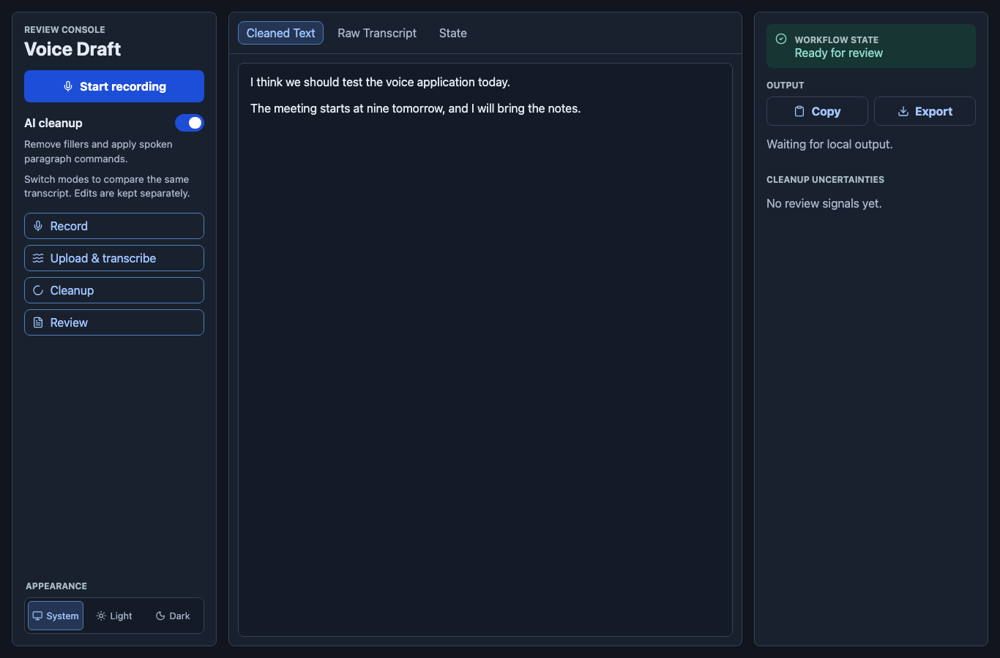

# Voice Draft

Record a thought, turn it into text, and decide how much cleanup it needs.
Voice Draft is a React and Spring Boot app that transcribes speech with OpenAI,
then optionally removes fillers and applies spoken paragraph breaks while
preserving your wording and meaning.



## What you can do

- Record directly in the browser and review the original transcript.
- Switch AI cleanup on or off to compare the **same transcript**, without
  transcribing the recording again.
- Say “new paragraph” to insert a paragraph break during cleanup.
- Open the Dictation guide beside AI cleanup for the supported command and examples.
- Edit each view separately, then copy or export your text.
- Review flagged ambiguities and choose system, light or dark appearance.

Cleanup preserves hedging such as “I think” and “maybe.” It is intended to make
spoken text readable, rather than summarize it or change its tone.

## How it works

1. **Capture:** the browser records audio with `MediaRecorder` and uploads it to
   the Spring Boot API.
2. **Transcribe:** a backend Spring AI adapter sends the audio to OpenAI. The
   browser retains the returned Raw Transcript.
3. **Clean up, optionally:** the browser sends that exact transcript to a separate
   cleanup endpoint. Spring AI requests structured Cleaned Text and review
   uncertainties from OpenAI.
4. **Review:** the browser caches both results and keeps edits separately.
   Switching modes reuses those results; retrying cleanup reuses the transcript.

The OpenAI key stays on the backend. Transcription and cleanup sit behind
separate Java interfaces, so their real adapters can be replaced with fakes in
tests and local demos.

| Layer | Stack |
| --- | --- |
| Browser | React 19, TypeScript, Vite 8, MediaRecorder |
| API | Java 25, Spring Boot 4.1, Spring AI 2.0, Maven |
| AI | `gpt-transcribe` for transcription; `gpt-6-luna` for optional cleanup |
| Tests | JUnit, Mockito, Vitest, React Testing Library, Playwright |

## Run locally

You need JDK 25, Maven, Node.js 24.18+ and npm. Allow microphone access when
prompted. Use two terminals from the repository root.

```bash
git clone https://github.com/igrgin/voice-draft.git
cd voice-draft
npm --prefix frontend ci
```

**Backend — real OpenAI calls:** make `OPENAI_API_KEY` available in your shell,
then run:

```bash
SPRING_PROFILES_ACTIVE=prod mvn -f backend/pom.xml spring-boot:run
```

For a **simulated demo without an API key**, omit the profile:

```bash
mvn -f backend/pom.xml spring-boot:run
```

**Frontend — in the second terminal:**

```bash
npm --prefix frontend run dev
```

Open [localhost:5173](http://localhost:5173). The frontend proxies API requests
to the backend on port 8080. The `prod` profile selects real providers; both
commands above run the app locally.

## Test and build

```bash
mvn -f backend/pom.xml test
npm --prefix frontend test
npm --prefix frontend run build
```

The automated suite covers API validation, cleanup behavior, recording and retry
flows, comparison caching, editing and responsive layout. It uses fake or mocked
AI responses and does not call OpenAI. Live voice checks are separate.

## Scope

Voice Draft currently targets English plain text and short recordings up to ten
minutes and 25 MB. It supports the exact standalone command “new paragraph.”
Other spoken editing commands are preserved as text.

Results live in browser memory. There are no accounts, saved history or realtime
transcription. Review the output before using it.

See the [development guide](docs/development.md) for API contracts, configuration,
retry details and troubleshooting, and the [domain notes](CONTEXT.md) for the
cleanup rules.
